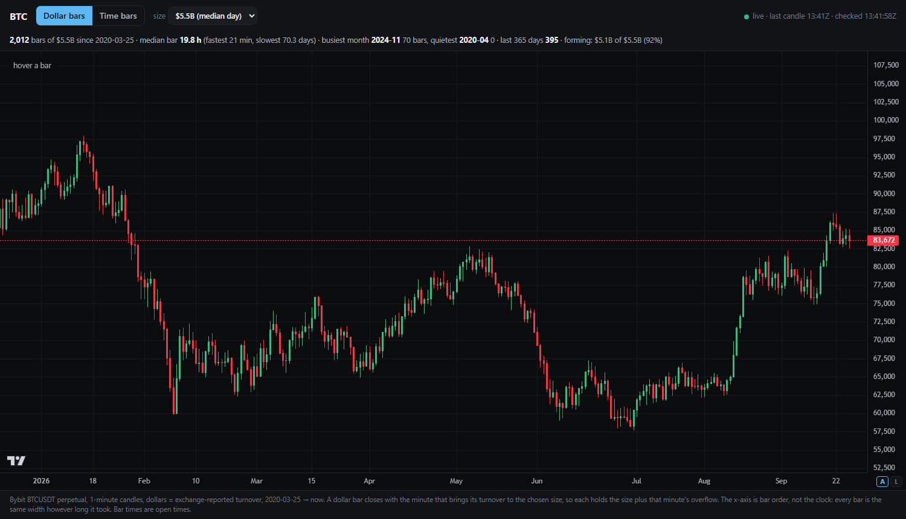

# dollarbarchart

A live **dollar-bar** chart for any coin, combined across the big exchanges, running on your own machine from
free data. Dollar bars
are the sampling scheme López de Prado recommends over time bars in *Advances in Financial Machine
Learning* (ch. 2): instead of closing a candle every N minutes, a bar closes every time **N dollars have
traded**. Busy periods produce many bars, quiet weekends produce few, and every bar carries the same
amount of market activity. TradingView does not draw them, so this does.



* **Combined across exchanges (the default).** A ticker's chart is every exchange that lists it, spot and
  perpetual: Binance, Bybit, OKX, Coinbase, KuCoin, Bitfinex. Dollars are summed; each minute's open, high,
  low and close is the dollar-weighted median of the exchanges that traded it, so one exchange's bad print
  cannot move the chart. History goes back as far as the oldest exchange (BTC: Bitfinex 2013). A market an
  exchange lists under the same ticker but for another coin is left out (latest price more than 10% off
  Bybit's), and so is history from before an exchange handed the symbol to this coin (a gap of 14+ days
  across which the price does not carry on, a 4x price jump in a day that Bybit did not make, or three days
  within a month more than 30% off Bybit's price). A gap where the price does carry on is only missing data
  (Bitfinex has no BTC minutes for April-May 2016): the history before it stays. The header says how many
  exchanges and markets are in; hover it for the list.
* **Any ticker.** Type `PUMP`, `HYPE`, `NVDA`… Enter opens the combined chart; the picker also lists each
  Bybit spot/perp market on its own, with how far back it goes.
* **Free data, no keys:** public 1-minute candles with exchange-reported turnover (Coinbase and Bitfinex
  report coin volume, so their dollars are volume × close), from each market's first trade to the current
  minute, polled every 5 s so the forming bar moves. Binance's history comes from its public archive
  (data.binance.vision, one file per month) and its live minutes from its websocket stream, so the app adds
  almost nothing to the request weight other Binance users on the same machine spend. Binance's archive is
  licensed for personal, non-commercial use.
* Bar sizes from a tenth of the market's median day to ten times it, plus the median 1h, 4h, week and month
  (last 365 days, whole UTC periods with trades), each labelled in the menu, plus ordinary time bars
  (1h, 4h, 1D, 1W, 1M) on the same chart for comparison.
* **Adaptive sizes** (≈24, ≈6 or ≈1 bar a day): each bar's size is the median day of the 30 days before it
  divided by the target, so a coin whose trading grew 100x keeps a steady number of bars through its whole
  history instead of squashing its early years into a handful of bars. Only past days set a size.
* TradingView-style chart (Lightweight Charts): drag the price or time axis to zoom, double-click to reset,
  `A` auto-scale and `L` log-scale buttons, OHLC + bar duration + dollars on hover, bar statistics in the
  header (count, median / fastest / slowest bar, busiest and quietest month, last 365 days, forming bar).
  Zooming out goes as far as the whole history.
* **Trend lines**, drawn like on TradingView: pick the tool in the left toolbar (or `Alt+T`), click two points
  or press-drag-release; hold `Shift` for a horizontal line. Click a line to select it, drag it or its ends,
  `Delete` removes it, double-click opens its settings (color with opacity, width, style, extend left/right,
  middle point, price labels, stats), `Ctrl+Z` / `Ctrl+Y` undo and redo, `Esc` cancels. The left toolbar also
  has stay-in-drawing-mode, lock all, hide all (`Ctrl+Alt+H`) and remove all. Drawings are saved per market
  and anchored by time and price, so they show on every bar size and time frame. Two app windows open at once
  show each other's changes and never overwrite each other; if a save fails (server restarting) the top bar
  says so in red and it is retried until it works.
* **Chart settings** (gear in the top bar): candle body, borders and wick on/off with up and down colors, and
  a solid or gradient background, all with opacity, in a TradingView-style color picker (its palette, your
  own custom colors, an opacity slider). Changes preview live; Cancel puts the chart back.
* **Nothing runs while the window is closed.** Downloads happen only while the app is open; two minutes
  after the last page request the server writes what it has to disk and exits. The next launch resumes.
* A **watchlist** (☆ next to the ticker) is downloaded in the background while the app is open, so those
  tickers open instantly later. Everything else is fetched the first time you pick it, all exchanges at once,
  and the chart grows while the download runs (a few minutes for a young coin; hours for the full BTC history
  on every exchange, because OKX and Coinbase hand out 300 minutes a request).
* Updates itself: when the files on disk change, a banner offers **Update now**, which reloads the page or
  restarts the server in place, without closing the window.

## Run

Needs Python 3.10+ with `numpy`, `pandas` and `pyarrow` (`pip install -r requirements.txt`).

* **Windows:** double-click `launch.cmd`. It starts the server (windowless), waits for it, and opens the
  chart as its own window in Edge or Chrome (falls back to your default browser). The window opens at the
  size and place you left it (the first time: 90% of the screen).
* **macOS / Linux:** `sh launch.sh`.
* **By hand:** `python server.py`, then open <http://127.0.0.1:8793/>.

Candles are stored per market in `data/` (about 16 MB per market-year; the full BTC perpetual history is
~110 MB). `data/watchlist.json` holds the watchlist; edit it or use the ☆ button. Your drawings are in
`data/drawings.json` and the chart settings in `data/settings.json`.

Every file in `data/` is written to a temporary file, forced to the disk, then swapped in, so a crash or a
power cut leaves either the old version or the new one. A market file that is damaged anyway (for example
by a power cut before this was in place) is moved aside as `<name>.parquet.damaged` and the market is
downloaded again; the chart says so while it happens. The `.damaged` copy can be deleted.

## How the bars are cut

A dollar bar opens with a 1-minute candle and closes with the candle whose turnover brings the dollars traded
*since the bar opened* to the chosen size. Every completed bar therefore holds at least the size, plus the
overflow of its final minute (at $5.5B on BTC the largest overflow in six years is 10%; at $1B a single
huge minute can overshoot by half). The forming bar is the incomplete tail and is redrawn every 5 seconds.
Bar times are open times, like TradingView; the x-axis is bar order, not the clock, so every bar is the
same width however long it took.

Time bars are the usual candles with weeks starting Monday 00:00 UTC and months on the 1st.

## Files

| file | role |
|---|---|
| `bybit_sync.py` | keyless Bybit v5 kline requests; one parquet per market; streaming, resumable, checkpointed backfill that stops within one request when asked |
| `markets.py` | instrument index (cached daily), ticker aliases (PUMPFUN → PUMP, NVDAX → NVDA), search ranking, deepest-history choice, watchlist file |
| `venues.py` | the other exchanges' 1-minute candles (Binance archive + REST + websocket, OKX, Coinbase, KuCoin, Bitfinex, and Bybit wrapped alike); one parquet per series in `data/<exchange>_<symbol>.parquet`; resumable syncs; which market means a ticker on each exchange |
| `combined.py` | the merge (dollars summed, dollar-weighted median prices) and the same-coin history check |
| `bars.py` | dollar bars and time bars from the candles, incrementally as new minutes arrive; per-market size menu |
| `server.py` | local HTTP server: `/bars?m=&k=` (full history of the set shown), `/live?m=` (last bars + forming bar), `/search?q=`, `/pick?t=`, `/watchlist`, `/drawings?m=`, `/settings`, `/static/…`, `/ping`, `/restart`; one download worker (on-screen market first, then depth probes, then the watchlist); idle exit |
| `userdata.py` | saved drawings (per market) and chart settings, written crash-safe like the candles; only the app's own page may change them |
| `index.html` | the page layout: top bar, drawing toolbar, chart |
| `static/app.js` | loading and live-updating the chart, ticker picker, watchlist, stats, legend, update banner |
| `static/draw.js` | the drawing tools (trend line), their toolbars and settings, undo/redo, saving |
| `static/settings.js` | the chart settings dialog (candles, background) |
| `static/window.js` | the app window's size and place, remembered between launches |
| `static/ui.js`, `static/app.css` | color picker, menus, dialogs; the page's styles |
| `lightweight-charts.js` | TradingView Lightweight Charts v5.2.1, vendored (Apache-2.0, logo must stay) |
| `tests/` | bar-cutting, search, crash-safety, saved-drawings and exchange/merge tests: `python tests/test_bars.py`, `python tests/test_markets.py`, `python tests/test_storage.py`, `python tests/test_userdata.py`, `python tests/test_venues.py` (or `pytest`) |

Market keys are `linear:SYMBOL` (perpetual) or `spot:SYMBOL`; the page keeps the current one in the URL
hash, so `http://127.0.0.1:8793/#spot:PUMPUSDT` opens that market directly.

## Developing without breaking the running app

The server watches its own files, so never edit the folder it runs from. Work on a branch in a separate
checkout on another port, then merge:

```
git worktree add .worktrees/my-feature -b my-feature
set DOLLARBARS_PORT=8794 && python .worktrees\my-feature\server.py      # its own data/ and logs/
```

When the branch is merged and pulled into the main checkout, the running app shows the update banner.

## Licence

MIT (see `LICENSE`). Lightweight Charts is Apache-2.0, © TradingView, Inc.
